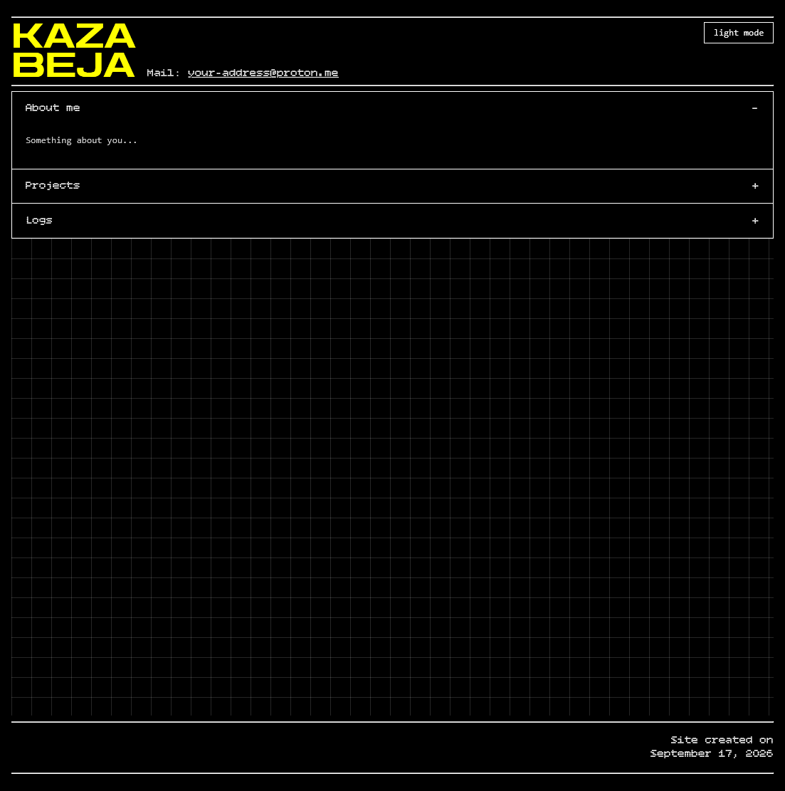
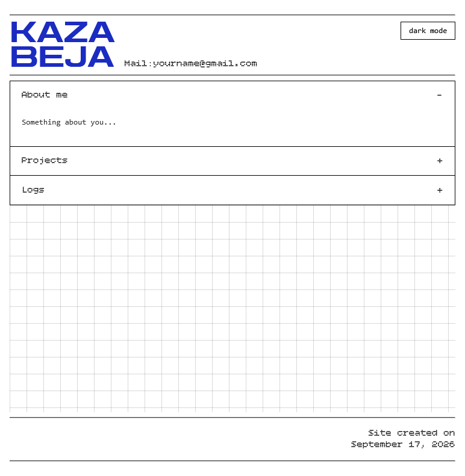

# Portfolio site
## Screenshots

| Dark theme | Light theme |
|---|---|
|  |  |

## Sections
- **About me** — background and areas of focus
- **Projects** — an overview of ongoing and past work
- **Logs** — a running record of what's being learned or built, and why

## Features
- Accordion-based navigation (native `
`/`
`, no JS required for the toggle itself)
- Light/dark theme switch, with the choice remembered across visits
- Custom typography (Zen Dots, Bitcount Grid Single)
- Notebook-style grid background

## Built with

Plain HTML, CSS, and vanilla JavaScript — no frameworks, no build step. Hosted on GitHub Pages.

## Live site

[PerfectPatch.github.io](https://PerfectPatch.github.io)

